# Physical data flow: football pipeline → Icebergkamp → ClickHouse → wilson

Snapshot 2026-11-05. Code citations: icebergkamp `origin/main` @ 76a69d8 (paths relative to
`workspace/skillcorner/data-engineering/icebergkamp`), wilson `origin/main` @ a35329f55, football
`origin/main`. Live state was read with read-only AWS/ClickHouse/Postgres calls. *(inferred)* marks
reasoning that was not directly observed.

**TL;DR.** In prod, v4 parquet lands in Iceberg (`physical_agg` 4.0) but is **not served**. ClickHouse
`physical_4_0_0` is a frozen 950-match snapshot read from the *dev* datalake. wilson has no v4 status,
and the v4 API exists only on `feat/physicalV4`. Today the pipeline exists to move **v3** (0.2/0.3)
matches from `csv_ready` to `saved_to_clickhouse`, and it shares one queue with v4.

## 1. Diagram

```mermaid
flowchart LR
  FM["SFN football_main-prod<br/>or football_historical_v4-prod (backfill)"] --> P4["SFN football_physical_v4-prod<br/>(EKS physical_v4)"]
  P3["SFN football_physical_v3-prod<br/>(EKS physical_v3 + λ physical_check)"] -->|"v3 csv.gz: physical_agg 0/1-0/3, physical_check 0/1"| RAW[("S3 skcr-football-data-raw-us-prod")]
  P4 -->|"v4 parquet 4/0 + events 4/0 (csv/json/xml)"| RAW
  P3 -.->|"physical_v3.ready"| SNS
  RAW -->|"EventBridge Object Created"| EBS["EB rule icebergkamp-football-physical-source-rule-prod"]
  EBS --> Q[["SQS icebergkamp-football-physical-queue-prod<br/>(DLQ after 3 receives)"]]
  CRON["EB rule …-physical-cron-rule-prod<br/>code hourly / live every 30 min"] --> SFN
  subgraph SFN["SFN icebergkamp-football-physical-sfn-prod"]
    T["PollPhysicalSQS<br/>trigger λ, MAX_MESSAGES"] --> M[("manifest s3://icebergkamp-football-pipeline-manifest-prod/physical/")]
    M --> G["Glue agg + check incremental<br/>(events, referee off)"]
    G --> C["CleanupPhysicalSQS λ"] --> R["RefreshClickHouseViews λ"] --> D{"publish_physical_domain_events<br/>(false in prod)"}
  end
  Q --> T
  G -->|"WAP scoped replace"| ICE[("Iceberg football_datalake_prod<br/>s3://football-iceberg-datalake-prod/{physical_agg,physical_check}")]
  R -->|"SYSTEM REFRESH VIEW"| CH[("ClickHouse football.physical_3_0_{2,3}_new")]
  ICE -->|icebergS3| CH
  D -.->|"physical_v4.ready (off)"| SNS(["SNS football-domain-events-prod"])
  SNS --> WQ[["SQS wilson-domain-events-prod (eu-central-1)"]] --> AD["λ apply_domain_events → csv_ready"]
  SYNC["ECS sync_physical_clickhouse_status<br/>every 5 min"] -->|"CH updated_at &gt; last_modified"| DC[("wilson DataCollection<br/>saved_to_clickhouse")]
  CH --> SYNC
  CH --> API["wilson /api/physical/"]
```



## 2. Steps and resources (account 891239948857)

| # | Step | Resource (prod) | Region | Trigger | Code | Console / logs |
|---|---|---|---|---|---|---|
| 1a | v3 CSVs + `physical_v3.ready` | SFN `arn:aws:states:us-east-1:891239948857:stateMachine:football_physical_v3-prod` | us-east-1 | `football_main` (see §2a) | football `pulumi/aws/main/physical_v3/step_function_config.yaml:125-173` | [SFN](https://us-east-1.console.aws.amazon.com/states/home?region=us-east-1#/statemachines/view/arn%3Aaws%3Astates%3Aus-east-1%3A891239948857%3AstateMachine%3Afootball_physical_v3-prod), logs `/aws/vendedlogs/states/football-sfn-state-transition-prod-Logs` (ERROR only) |
| 1b | v4 parquet + events | SFN `arn:aws:states:us-east-1:891239948857:stateMachine:football_physical_v4-prod` (EKS `workloads-prod`/`football`) | us-east-1 | `football_main` or `football_historical_v4` | football `pulumi/aws/main/physical_v4/step_function_config.yaml:1-89`, `physical_v4/app.py:47-135` | [SFN](https://us-east-1.console.aws.amazon.com/states/home?region=us-east-1#/statemachines/view/arn%3Aaws%3Astates%3Aus-east-1%3A891239948857%3AstateMachine%3Afootball_physical_v4-prod), same log group |
| 2 | Raw files | S3 `skcr-football-data-raw-us-prod` (EventBridge enabled, **no** S3→SQS notification) | us-east-1 | — | `pulumi/021_compute_football/stack_configuration.py:45` | [bucket](https://s3.console.aws.amazon.com/s3/buckets/skcr-football-data-raw-us-prod?prefix=physical/) |
| 3 | Route events | EB rule `arn:aws:events:us-east-1:891239948857:rule/icebergkamp-football-physical-source-rule-prod`. Filters on bucket, Object Created and the 4 prefixes `physical/{physical_agg,physical_events,physical_agg_referee,physical_check}/` | us-east-1 | S3 event | `event_source.py:79-117`, `pipeline_physical.py:36-39,121-142` | [rule](https://us-east-1.console.aws.amazon.com/events/home?region=us-east-1#/eventbus/default/rules/icebergkamp-football-physical-source-rule-prod) |
| 4 | Buffer | SQS `arn:aws:sqs:us-east-1:891239948857:icebergkamp-football-physical-queue-prod`: visibility 3600 s, retention 4 d (AWS default), DLQ `…-physical-dlq-prod` after 3 receives (14 d) | us-east-1 | — | `event_source.py:58-75` | [queue](https://us-east-1.console.aws.amazon.com/sqs/v3/home?region=us-east-1#/queues/https%3A%2F%2Fsqs.us-east-1.amazonaws.com%2F891239948857%2Ficebergkamp-football-physical-queue-prod), [DLQ](https://us-east-1.console.aws.amazon.com/sqs/v3/home?region=us-east-1#/queues/https%3A%2F%2Fsqs.us-east-1.amazonaws.com%2F891239948857%2Ficebergkamp-football-physical-dlq-prod) |
| 5 | Schedule | EB rule `…/icebergkamp-football-physical-cron-rule-prod`, prod only. Code: `cron(0 * * * ? *)`. **Live: `cron(0/30 * * * ? *)`** (manual edit 2026-11-05) | us-east-1 | cron | `pipeline_physical.py:196`, `sfn.py:154-198` | [rule](https://us-east-1.console.aws.amazon.com/events/home?region=us-east-1#/eventbus/default/rules/icebergkamp-football-physical-cron-rule-prod) |
| 6 | Orchestrate | SFN `arn:aws:states:us-east-1:891239948857:stateMachine:icebergkamp-football-physical-sfn-prod` (STANDARD, **logging OFF**) | us-east-1 | step 5 | `pulumi/step_functions/football_physical_pipeline.json`, `sfn.py:39-151` | [SFN](https://us-east-1.console.aws.amazon.com/states/home?region=us-east-1#/statemachines/view/arn%3Aaws%3Astates%3Aus-east-1%3A891239948857%3AstateMachine%3Aicebergkamp-football-physical-sfn-prod) |
| 6a | Drain queue → manifest | λ `icebergkamp-football-physical-trigger-prod` (300 s) writes `s3://icebergkamp-football-pipeline-manifest-prod/physical/<uuid>.json` (30-day expiry) | us-east-1 | `PollPhysicalSQS` | `pulumi/lambda/football/claimcheck_trigger.py:45,76,88-156` | [logs](https://us-east-1.console.aws.amazon.com/cloudwatch/home?region=us-east-1#logsV2:log-groups/log-group/$252Ficebergkamp$252Flambda$252Ficebergkamp-football-physical-trigger-prod) |
| 6b | Load Iceberg | Glue `icebergkamp-football-physical-{agg,check}-incremental-prod` (Glue 6.0, G.1X, 10/2 workers, max 1 concurrent run). `events`/`agg_referee` jobs exist but are skipped | us-east-1 | `RunPhysicalJobs` | `glue.py:208-282`, `pulumi/glue_jobs/football/physical/physical_agg_incremental_job.py:67-136`, `physical_utils.py` | [agg job](https://us-east-1.console.aws.amazon.com/gluestudio/home?region=us-east-1#/editor/job/icebergkamp-football-physical-physical_agg-incremental-prod/details), logs `/aws-glue/icebergkamp-football-prod/{output,error}` |
| 6c | Ack | λ `icebergkamp-football-physical-cleanup-prod`. Code timeout 60 s; **live 840 s** (manual edit) | us-east-1 | `CleanupPhysicalSQS` | `claimcheck_cleanup.py:24-63`, `event_source.py:215` | [logs](https://us-east-1.console.aws.amazon.com/cloudwatch/home?region=us-east-1#logsV2:log-groups/log-group/$252Ficebergkamp$252Flambda$252Ficebergkamp-football-physical-cleanup-prod) |
| 6d | Refresh CH | λ `icebergkamp-football-clickhouse-refresh-lambda-prod` (shared, VPC, secret `wemby/prod/clickhouse-migration-credentials`) → `SYSTEM REFRESH VIEW football.physical_3_0_3_new_refresh`, `…3_0_2_new_refresh`, 60 s apart, fire-and-forget | us-east-1 | `RefreshClickHouseViews` | `pulumi/lambda/football/clickhouse_view_refresh.py:38-139`, `clickhouse.py:64-188` | [logs](https://us-east-1.console.aws.amazon.com/cloudwatch/home?region=us-east-1#logsV2:log-groups/log-group/$252Ficebergkamp$252Flambda$252Ficebergkamp-football-clickhouse-refresh-lambda-prod) |
| 6e | Domain events (off) | λ `icebergkamp-football-physical-domain-events-prod` + Map → SNS `arn:aws:sns:us-east-1:891239948857:football-domain-events-prod` | us-east-1 | `ShouldPublishDomainEvents` | `physical_domain_events.py:44-93`, `stack_configuration.py:82-88` | [logs](https://us-east-1.console.aws.amazon.com/cloudwatch/home?region=us-east-1#logsV2:log-groups/log-group/$252Ficebergkamp$252Flambda$252Ficebergkamp-football-physical-domain-events-prod) |
| 7 | Iceberg tables | Glue DB `football_datalake_prod`: `physical_agg`, `physical_check` (+ legacy frozen `physical`, `match_infos`). Warehouse `s3://football-iceberg-datalake-prod/` | us-east-1 | — | `ingest_common.py:121-248` | [Glue tables](https://us-east-1.console.aws.amazon.com/glue/home?region=us-east-1#/v2/data-catalog/tables?database=football_datalake_prod) |
| 8 | Serving copy | ClickHouse Cloud `football.physical_3_0_{2,3}_new` (ReplacingMergeTree) ← refreshable MV `*_new_refresh` (`REFRESH EVERY 100 YEAR APPEND`, i.e. manual only) reading `icebergS3(...physical_agg)` via role `wemby-clickhouse-iceberg-access-prod` | ClickHouse | step 6d | wemby `origin/fm/wemby-new-metric-cols` `app/dbstate/specs.py:455-474`, `sql/physical_3_0_3_new_select.sql:50-70` (unmerged) | `system.view_refreshes` |
| 9 | `csv_ready` | SQS `wilson-domain-events-prod` (eu-central-1) → λ `apply_domain_events` | eu-central-1 | `physical_v3.ready` | wilson `server/son/domain_events_mapping.py:80-85`, `pulumi/aws/management/apply_domain_events/app.py:340-384` | [λ logs](https://eu-central-1.console.aws.amazon.com/cloudwatch/home?region=eu-central-1#logsV2:log-groups/log-group/$252Faws$252Flambda$252Fwilson-apply_domain_events-prod) *(log group name inferred)* |
| 10 | `saved_to_clickhouse` | ECS scheduled task `sync_physical_clickhouse_status`: `rate(5 minutes)`, prod only, 256 CPU / 512 MB | eu-central-1 | cron | wilson `server/phys_clickhouse/status_sync.py`, `pulumi/aws/management/sync_physical_clickhouse_status/ecs_task_config.yaml:1-15` | [logs](https://eu-central-1.console.aws.amazon.com/cloudwatch/home?region=eu-central-1#logsV2:log-groups/log-group/wilson-prod) stream prefix `sync_physical_clickhouse_status-prod` |
| 11 | Serve | wilson `/api/physical/` → `football.physical_3_0_{2,3}_new FINAL` + `football.physical_scope` | eu-central-1 | HTTP | `server/api/views/physical_version_selection_view.py:18-29`, `physical_clickhouse_query_builder.py:442,838,1061` | — |
| 12 | Probe | λ `wilson-data_readiness_probe-prod` `check=physical_db` (3.0.3 must be `saved_to_clickhouse`), then `physical_api` | eu-central-1 | hourly | `pulumi/aws/third_party_provider/data_readiness_probe/serving.py:14,130-166` | log group `/aws/lambda/wilson-data_readiness_probe-prod` |

**Grafana.** The wilson dashboard `grafana/dashboards/wilson-data-readiness-serving.json` (title "Wilson -
Data Readiness: Serving"; Physical panel :205; "not ingested vs not served" :939). The Icebergkamp
dashboard `grafana/Icebergkamp – Football pipelines (prod)-1791806139038.json` (uid
`icebergkamp-football-pipeline-2`), with panels Queue depth (now) :1749, Queue backlog :1902, Glue run
duration :2650, and Why: Glue failure categories :3016.

### 2a. Producer (football)
Citations are football `origin/main`. Keys are resolved by guardiola schema classes, not built by hand.
- **v3: `football_physical_v3-prod`.**
  - States: Start → Checks → Check Data Quality → Possession Physical (EKS) → **Physical v3** (EKS,
    writes `physical/physical_agg/0/{1,2,3}/csv/<match>.csv.gz`, `physical_v3/app.py:207`) → **Physical
    Check** (λ, writes `physical_check/0/1`, `physical_check/app.py:85`).
  - Then **Publish Domain Event (Physical V3)**: SNS `football-domain-events-prod`, 6 retries, no Catch
    (`step_function_config.yaml:152-173`). The payload is built in `physical_check/app.py:98-104`
    with `variants=[v3, v3_0_3]` and `occurred_at=now`.
  - Then Save Minutes played to DB.
  - v3 *events* go to `skcr-algo/prod/<match_name>/physical_events*.csv`, not to `physical/`.
- **v4: `football_physical_v4-prod`.**
  - One execution per match: Start → Checks (skipped if `check_already_done`) → `Physical V4`
    (`eks:runJob.waitForTaskToken`, 2 CPU, 3/5 GiB, `activeDeadlineSeconds 7200`, priority
    `cpu-prod-filler-low`, Kueue `football`).
  - Writes `physical_agg/4/0/parquet`, `physical_agg_referee/4/0/parquet`,
    `physical_quality_index/4/0/parquet` (not in the EB prefixes), and `physical_events/4/0/{csv,json,
    focus_json,sportscode_xml,matchtracker_xml}`. There is **no events parquet**
    (`physical_v4/app.py:69-92`, `utils.py:37-61`).
  - It emits **no domain event**. `physical_v4.ready` is not in skcr-models `EventName`; the skcr-models
    test asserts it is rejected (`tests/test_domain_events.py:220-222`). So even if Icebergkamp turned
    publishing on, wilson's current contract would reject the event *(inferred)*.
- **What starts them.** No EventBridge rule. `football_main` runs `Tracking Delivery and Physical V4`
  (`pulumi/aws/main/step_function_config.yaml:524-560`), and backfills run through
  `football_historical_v4-prod` (`pulumi/aws/standalone/historical_v4/step_function_config.yaml:100-136`).
  Executions are named `<match>-<ts>_by_<requester>`. `kwargs.requester` and `eks_context_tag` (e.g.
  `historical_recompute` / `tracking-v4-2026-11`) identify a backfill. The launch was probably francli
  `run-sfn` via Busquets *(inferred)*.

## 3. What the Icebergkamp SFN does
1. `SetEnabledKinds` (Pass, json :414-425): the enabled kinds come from Pulumi config.
2. `PollPhysicalSQS` drains the queue with `receive_message(10, wait 1 s)` until the queue is empty or
   `MAX_MESSAGES` receipts are collected.
   - Format rule: `parquet` if the major version is ≥4, otherwise `csv` (`claimcheck_trigger.py:76`).
   - Every message gets a receipt, including ones it skips. Malformed ones are not receipted, so SQS
     redelivers them and they end up in the DLQ.
   - Manifest shape: `{"files": {kind: {match_id: ["maj.min", …]}}, "receipts": [{Id, ReceiptHandle}]}`.
3. `CheckMatchCount`: when the batch has 0 matches, the SFN runs the cleanup and stops.
4. `RunPhysicalJobs` (Parallel): runs `glue:startJobRun.sync` with `--manifest_s3_uri`. There is no
   `Retry`; Glue `MaxRetries=0`.
   - Glue keeps only physical_agg versions `0.2`, `0.3` and `4.0` (`physical_utils.py:61-63`).
   - The write is WAP: on branch `ingest_staging` it tombstones live `(match_id, version)` rows, inserts
     the new rows, then fast-forwards `main` (`ingest_common.py:159-248`).
5. `CheckJobFailures`: if any job failed, the SFN fails with `PhysicalJobFailure` and **nothing is
   acked**. The messages come back after 1 h, and the retry is idempotent.
6. `CleanupPhysicalSQS` runs `delete_message_batch` ×10 for every receipt in the manifest.
7. `RefreshClickHouseViews` triggers only the two v3 `_new` views. The v4 views are never refreshed.
8. `ShouldPublishDomainEvents` sends `physical_v4.ready` per match, with variants from the manifest
   (`0.x`→`v3_0_x`, `4.0`→`v4_0_0`). It announces whatever the manifest lists, not what Glue
   actually loaded (`physical_domain_events.py:23-25`).

## 4. Status machine (wilson `DataCollection`)
Fields: `physical_v3_*` (3.0.2, "official") and `physical_v3_0_3_*` (3.0.3, "future")
(`server/son/models/data_collection.py:169-178`; enum `server/son/models/utils.py:75-81`).

| Value | Set by | When |
|---|---|---|
| `unprocessed` | model default | — |
| `csv_ready` | λ `apply_domain_events` on `physical_v3.ready` (`domain_events_mapping.py:80-85`), `last_modified=occurred_at`; also manual `POST /api/match/{id}/physical/` (`physical_v3_from_s3_view.py:541-553`), `last_modified=now` | after the producer writes the v3 CSV |
| `saved_to_clickhouse` | ECS `sync_physical_clickhouse_status` (`status_sync.py:62-91`). Rows go pending when their status is in {csv_ready, saving_in_progress, error_during_save} and `last_modified ≥ now-7d`. The update is guarded on the same `last_modified` and sets `last_modified=now`. Migration 0282 also rewrote every `saved_to_redshift` row to this value | within ≤5 min of the CH table's `max(updated_at)` passing `last_modified` |
| `saving_in_progress`, `error_during_save` | nothing on main (left over from the Redshift save job removed in 8c8512629) | still treated as pending |
| `deleted` | `DELETE /api/match/{id}/physical/`, `son/match_data_deletion.py:94-101` | manual |

- Only `DataCollection` is synced; `VideoDataCollection` is not.
- **v4 has no status on main.** `origin/feat/physicalV4` (820902d74, unmerged) adds `physical_v4_0_status`
  and `physical_events_v4_0_status` with migration 0283, but nothing writes them.
- The probe passes only when 3.0.3 is `saved_to_clickhouse`.

## 5. Knobs and limits

| Knob | Value | Where |
|---|---|---|
| Enabled kinds | `physical_agg,physical_check` (default; `Pulumi.prod.yaml` sets no keys) | icebergkamp `stack_configuration.py:64-71`, rendered `pipeline_physical.py:186-193` |
| `MAX_MESSAGES` | code 5000; **live 20000** (manual, 2026-11-05) | `claimcheck_trigger.py:45` |
| Schedule | code hourly; **live every 30 min** (manual) | `pipeline_physical.py:196` |
| Cleanup λ timeout | code 60 s; **live 840 s** (manual) | `event_source.py:215` |
| Glue execution class | code FLEX; **live STANDARD** for agg and check (manual `UpdateJob`; class change inferred) | `glue.py:232-233` |
| Glue timeout | 120 min live, not set in code | — |
| `publish_physical_domain_events` | false in prod and dev | `stack_configuration.py:82-88`, `pipeline_physical.py:183-185` |
| Refresh match cap | `REFRESH_MATCH_CAP=3000` per refresh (wemby, unmerged branch) | wemby `app/dbstate/specs.py:21-28,137` |
| Sync window / stuck | `WINDOW=7d`, `STUCK_AFTER=6h`, `STUCK_REPORT_SPAN=15m`, `BATCH_SIZE=300`, `SCOPE_STALE_AFTER=10m` | wilson `server/phys_clickhouse/status_sync.py:23-29` |
| Queue | visibility 3600 s, DLQ after 3 receives, retention 4 d | `event_source.py:69-71` |

**Drift warning.** A `pulumi up` on icebergkamp prod reverts every "live" value above.

## 6. Failure modes and how to diagnose them
Shell prefix: `export AWS_PROFILE=Production.Skcr-Software-Common-Role`.

- **Backlog: the queue fills faster than one run drains it.** Matches stay in `csv_ready`, and the sync
  task logs `Physical 3.0.x not in ClickHouse 6:00:00 after the pipeline announced it`.
  ```bash
  aws cloudwatch get-metric-statistics --region us-east-1 --namespace AWS/SQS --metric-name ApproximateNumberOfMessagesVisible --dimensions Name=QueueName,Value=icebergkamp-football-physical-queue-prod --start-time 2026-11-04T00:00:00Z --end-time 2026-11-05T12:00:00Z --period 3600 --statistics Maximum
  ```
  Also check `ApproximateAgeOfOldestMessage`. Throughput is at most `MAX_MESSAGES` per run.
- **A Glue job fails.** The SFN ends `JobsFailed`, no ack happens, and the batch reappears 1 h later. Read
  `/aws-glue/icebergkamp-football-prod/error` and the Grafana "Why: Glue failure categories" panel. After 3
  failures the messages go to the DLQ; check the DLQ depth.
- **The cleanup times out** (the 2026-11-05 10:00 UTC run). Glue succeeds, but
  `CleanupPhysicalSQS` raises `Sandbox.Timedout`, so `RefreshClickHouseViews` never runs. The un-deleted
  messages are redelivered and count toward the 3 receives.
  ```bash
  aws stepfunctions get-execution-history --region us-east-1 --execution-arn <arn> --reverse-order --max-results 30
  ```
- **The refresh fails silently.** The λ is fire-and-forget. Query
  `SELECT view,status,last_success_time,exception FROM system.view_refreshes WHERE database='football'`.
  The wilson sync also errors if `physical_scope_refresh` is older than 10 min.
- **A match stays in `csv_ready` even though CH has it.** It is outside the 7-day window, or its
  `last_modified` (manual POST sets `now`) is later than the CH `updated_at`. Compare
  `SELECT max(updated_at) FROM football.physical_3_0_3_new WHERE match_id=X` against the DB row.
- **A message is malformed or its key is unknown.** It is never receipted, so it ends in the DLQ.
- **Manifest too big for domain events (if enabled).** The variants list travels in SFN state (256 KB, about
  1,500 matches). A 3k-match batch would fail *(inferred)*.

ClickHouse access: Secrets Manager `/prod/wilson/CLICKHOUSE_CREDS` (eu-central-1). Use the `public_host`
field on port 8443 over HTTPS, and only run SELECTs.

Read-only Postgres check:
```sql
SET default_transaction_read_only = on;
SELECT physical_v3_0_3_status, count(*) FROM api_datacollection
WHERE physical_v3_0_3_last_modified > now() - interval '7 days' GROUP BY 1;
```

### Worked example: 2026-11-04/05 v4 backfill
- **Cause.** A v4 backfill via `football_historical_v4-prod` → `football_physical_v4-prod` (requester
  `paul_nantas`, `eks_context_detail_tag=tracking-v4-2026-11`). physical_v4 executions started per hour
  went from 8 (10:00 UTC) to 121 (11:00) and 1.6k–3k (14:00–00:00), with 37k succeeded and 0 failed by
  11-05 12:00 UTC. The v4 runs wrote v4 files, and every file became a message on the shared queue. Messages sent/h went from
  ~50 to 14–27k.
- **Backlog growth.** `ApproximateNumberOfMessagesVisible` (hourly max) was 1,002 at 11:00, 36,557 at
  15:00, 163,497 at 23:00 and **220,049 at 11-05 10:00 UTC**. Deleted/h was flat at 5,000 (= `MAX_MESSAGES`),
  and the oldest message reached 59,644 s (~16.5 h).
- **Manifest content.** The 10:00 UTC manifest held 30,000 receipts, after `MAX_MESSAGES` was raised.
  - physical_agg: 3,334 matches, nearly all 4.0, with only 13 at 0.3 and 13 at 0.2.
  - agg_referee: 3,320 matches (4.0).
  - check: 13 matches.
  So each run moved only a handful of v3 matches, and new postmatch v3 matches waited in line behind v4.
- **Example match 2083329.**
  - ClickHouse `physical_3_0_2_new` max `updated_at` is 05:02:31; `physical_3_0_3_new` is 05:03:35.
  - The sync log at 05:08:40 shows `{'3.0.2': 0, '3.0.3': 1}`, and DB 3.0.3 `last_modified` is 05:08:40.
  - 3.0.2 had already flipped at 04:08:42. *(Inferred: an earlier load was then re-upserted at 05:02.)*
- **Example still stuck: match 2091605.** `csv_ready` since 11-04 22:44 UTC, with the stuck error
  logged at 04:48–04:58.
- **Impact at ~11:00 UTC.** 96 3.0.3 rows pending in the 7-day window, of which 63 had been waiting more than 2 h.
- **Mitigation already applied by hand (CloudTrail, `alexandre_lemercier`, 11-05 ~10:00–10:30 UTC).** Cron set
  to every 30 min, `MAX_MESSAGES=20000`, cleanup timeout 840 s, Glue agg/check set to STANDARD. The 10:00
  UTC run (30k receipts) then failed in cleanup on the old 60 s timeout.
- **Risks still open** *(inferred)*:
  - Redelivered messages burn receive counts toward the DLQ.
  - The 4-day retention could expire unprocessed messages if throughput doesn't keep up.
  - These manual changes are not in code.

## 7. How v4 is served or consumed
- **Iceberg.** `physical_agg` 4.0 rows are loaded in prod. The `physical_events` and `physical_agg_referee`
  tables do not exist in the prod catalog. The raw `physical_events/4/0` prefix has no parquet (only
  csv/json/xml formats), so the events kind would be a no-op even if enabled.
- **ClickHouse.**
  - `physical_4_0_0`, `physical_events_4_0_0` and `physical_referee_4_0_0` exist.
  - Their refresh MVs read the **dev** bucket `football-iceberg-datalake-dev/physical_agg_backfill_check`
    (and `…-dev/physical_check`, `match_infos`).
  - They have never refreshed (`last_success_time` NULL), and nothing triggers them.
  - Data: 950 matches, last `updated_at` 2026-10-07.
- **wilson main.** The client `physical-v4` pages (admin-guarded) call `/api/physical?data_version=4.0`,
  which returns "Unsupported version", and `/api/physical/column-count`, which does not exist.
  `origin/feat/physicalV4` adds `server/physical_v4/` (tables `physical_4_0_0`, `physical_referee_4_0_0`),
  secret `wemby/prod/clickhouse-physical-credentials`, and the `PHYSICAL_V4_RELEASED=False` flag.
- **Other consumers.** wemby owns the ClickHouse DDL (specs on an unmerged branch).
  `physical_scope_refresh` (every 1 min) builds the player scope from PeerDB-replicated `api_*` tables.

## 8. Flipping wilson from polling to events
1. **Contract + Icebergkamp.**
   - Enable publishing and emit a *loaded* event after Glue succeeds. Today's event is built from the
     manifest; !2738 expects `physical.loaded`.
   - Its `occurred_at` must be later than the `physical_v3.ready` one.
   - Batch the publishing outside SFN state, which is limited to 256 KB.
2. **skcr-models.** Add `EventName.PHYSICAL_LOADED` / `PhysicalLoadedVariant`, then bump wilson's locks
   (main pins skcr-models 0.33.0; unverified whether it has them).
3. **wilson.** Rebase !2738 (`origin/feat/physical-v4-ready-mapping`).
   - Drop its enum and migration (0278 collides; 0282 already covers it).
   - Keep the mapping and the empty-fields guard.
   - **If wilson!2838 is merged** (it turns the `wilson-domain-events` subscription filter from
     `anything-but playing_time.computed` into an allowlist, `DOMAIN_EVENTS` in
     `pulumi/01_infrastructure/domain_events_queue.py`), add `'physical.loaded'` to that list in the
     same MR; `test_domain_events_queue_filter_matches_the_mapping` enforces list == `set(EventName) - FOREIGN_EVENTS`.
     Without !2838, the old filter already admits it.
   - Under the allowlist an unlisted event is **silently dropped by SNS** (no DLQ, no alarm, SNS
     filtered-out metric is per topic only). So "wilson DLQ empty" proves nothing: verify positively
     (consumer logs show `physical.loaded` applied, new matches reach `saved_to_clickhouse` via the
     event) before removing the sync task.
   - Icebergkamp-only events added to skcr-models must still be added to wilson's `FOREIGN_EVENTS`
     at the next bump (coverage tests), but producers can publish before wilson knows them.
4. **Then merge d536ffabd** (unmerged, branch `chore/remove-pulumi-redshift-references`), which removes
   the sync task. First rehome its stuck alarm and the `physical_scope_refresh` health check. Then backfill
   the leftover pending rows once.
5. **For v4.** Map `v4_0_0` to the `feat/physicalV4` columns, and point `physical_4_0_0_refresh` at the
   prod `physical_agg` table (version 4.0) inside the refresh list.

## 8b. wilson!2858: v4 DataCollection columns (in review 2026-11-10)
- Adds `physical_v4_0_{status,last_modified,quality_index}` and `physical_events_v4_0_{status,last_modified}`
  on DataCollection and VideoDataCollection (migration `0284`, staff-only serializer fields), son 0.97.0,
  skcr-models >= 0.37.0 (`PhysicalLoadedEvent.data.match_physical_qi`).
- Mapping (`son/domain_events_mapping.py`): only `physical.loaded` with `v4_0_0` moves the v4 columns
  (`saved_to_clickhouse`, QI = `match_physical_qi`, null allowed). `physical.ready` never touches v4,
  because v4 is served from ClickHouse only. `physical_events.loaded` with `v4_0_0` moves the events columns;
  without `v4_0_0` it maps to `{}`. On main it has no mapping and hits the `ValueError` at the end, so it goes to the DLQ.
- Freshness gate: `column_groups` picks the longest `*_last_modified` stem as prefix, so `physical_v4_0_quality_index`
  is gated with `physical_v4_0_last_modified`. A late event can't roll the QI back.
- Review gaps: `delete_physical_data_from_match` (`son/match_data_deletion.py`) resets only the v3 columns.
  The `apply_domain_events` lambda lock (son 0.96.2, skcr-models 0.34.0) needs a relock or the mapping
  never runs. `PhysicalV4Status` is defined twice (`CustomTextChoices` and `TextChoices`).
- As of 2026-11-10, main's subscription filter is still `anything-but playing_time.computed` (!2838 not merged).

## 9. Open questions / not verified
- Whether `football-iceberg-datalake-dev/physical_agg_backfill_check` still exists. It is not in a catalog.
- Exact fields of the 11-05 `UpdateJob` calls (the CloudTrail payload was truncated). Who set the Glue
  120-min timeout.
- Prod ClickHouse DDL source of truth: the wemby specs are on an unmerged branch. `physical_scope` DDL
  was not found in any repo.
- The `apply_domain_events` log group name.
- How `football_historical_v4` was launched (francli/Busquets) and Kueue quotas.
- Stale docs: icebergkamp `README.md:10` and `openspec/specs/clickhouse-view-refresh/spec.md:13` (old
  view names). `CONTEXT.md:43` says "hourly". The wilson admin badge map still lists `saved_to_redshift`
  (`server/api/admin/base.py:18`).
